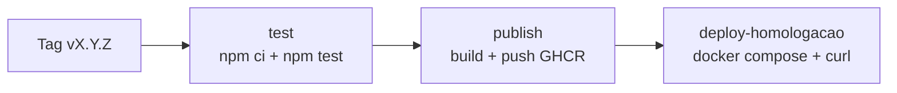

# entregas-devops

Projeto da disciplina **Integração DevOps** (Ciência da Computação 2026_2, CEUB, Prof. Danilo Silva).

Uma aplicação Node.js simples (calculadora) usada como base para praticar um fluxo DevOps completo: versionamento no Git, testes automatizados, integração contínua (CI), conteinerização com Docker, orquestração com Docker Compose e entrega contínua (CD) com publicação de imagens versionadas e rollback.

## Equipe

| Integrante         | Função |
|---|---|
| Davi Alves Martins | Desenvolvedor|

## Tecnologias

- Node.js 20 e JavaScript (CommonJS)
- Jest (testes automatizados)
- GitHub Actions (CI e CD)
- Docker e Docker Compose
- PostgreSQL 16
- GitHub Container Registry (GHCR)

## Estrutura do repositório

```
.
├── .github/workflows/
│   ├── ci.yml            # Pipeline de CI (A1)
│   ├── cd.yml            # Pipeline de CD (A2)
│   └── rollback.yml      # Rollback manual para uma versão anterior (A2)
├── docs/
│   └── rollback.md       # Simulação documentada de rollback (A2)
├── src/
│   ├── calculadora.js    # Lógica da aplicação (soma e subtrai)
│   └── server.js         # Servidor web com interface e API (A2)
├── tests/
│   └── calculadora.test.js
├── .dockerignore
├── .env.example          # Modelo das variáveis de ambiente
├── .gitignore
├── Dockerfile
├── docker-compose.yml
├── package.json
└── package-lock.json
```

## A aplicação

A lógica fica em `src/calculadora.js`, que exporta duas funções: `soma(a, b)` e `subtrai(a, b)`.

Na A2, o `src/server.js` expõe essa lógica em uma página web e em uma API HTTP, sem dependências externas:

| Rota | Descrição |
|---|---|
| `GET /` | Página com a interface da calculadora |
| `GET /health` | Retorna `{"status":"ok","banco":true/false}`; verifica se o PostgreSQL está acessível |
| `GET /api/operacoes` | Lista as operações disponíveis |
| `GET /api/calcular?op=soma&a=2&b=3` | Executa a operação e retorna `{"resultado":5}` |

## Fase 1 (A1): Integração Contínua

- **Testes:** `tests/calculadora.test.js` (Jest) cobre `soma` e `subtrai`.
- **Pipeline de CI:** `.github/workflows/ci.yml` roda a cada `push` e a cada `pull request` na branch `main`. As etapas são: baixar o código, configurar o Node.js 20 (com cache do npm), instalar dependências com `npm ci` e executar `npm test`.
- **Repositório:** o `node_modules` e o `.env` ficam fora do Git (`.gitignore`).
- **Estratégia de ramificação:** [Pull Request]
- **Padrão de commits:** [´feat:´]

## Fase 2 (A2): IaC e Entrega Contínua

### Dockerfile

O `Dockerfile` usa **multi-stage build**: o primeiro estágio instala só as dependências de produção (`npm ci --omit=dev`) e o estágio final copia apenas o necessário (`node_modules`, `package*.json` e `src`). A imagem fica menor e roda com o usuário não-root `node`. O `.dockerignore` evita copiar `node_modules`, `.git`, `.env` e testes para dentro da imagem.

### Orquestração local (Docker Compose)

O `docker-compose.yml` sobe dois serviços:

- **app:** a aplicação Node.js, exposta na porta 3000.
- **db:** PostgreSQL 16, com volume `dbdata` e `healthcheck` (`pg_isready`).

O serviço `app` só inicia depois que o banco está saudável (`depends_on` com `condition: service_healthy`). As credenciais vêm de variáveis de ambiente (`DB_USER`, `DB_PASSWORD`, `DB_NAME`), nunca escritas no código.

### Pipeline de CD

O arquivo `.github/workflows/cd.yml` dispara quando uma tag no formato `v*.*.*` é criada.



1. **test:** instala as dependências e roda os testes. Se falhar, nada é publicado.
2. **publish:** constrói a imagem e publica no GitHub Container Registry (`ghcr.io/davi-alves-martins/entregas-devops`), com as tags semânticas `X.Y.Z` e `X.Y`.
3. **deploy-homologacao:** ambiente de homologação simulado. Gera o `.env` a partir dos secrets, sobe o `docker compose` e valida a aplicação com `curl` (com novas tentativas enquanto o app inicia). Se algo falhar, uma etapa de diagnóstico mostra o estado dos containers e o log do app.

### Gestão de segredos

Os valores sensíveis ficam em **Settings → Secrets and variables → Actions**:

| Secret | Uso |
|---|---|
| `DB_USER` | Usuário do PostgreSQL |
| `DB_PASSWORD` | Senha do PostgreSQL |
| `DB_NAME` | Nome do banco |

No repositório existe apenas o `.env.example`, com valores fictícios. O `.env` real está no `.gitignore`.

### Versionamento semântico e rollback

As imagens e releases seguem o formato `MAJOR.MINOR.PATCH`, e cada versão fica guardada no GHCR. O workflow `.github/workflows/rollback.yml` (execução manual em **Actions → Rollback → Run workflow**) recebe uma versão, baixa a imagem correspondente e sobe o container para validar o retorno. A simulação está documentada em [`docs/rollback.md`](docs/rollback.md).

Resultado da simulação: [As versões v1.0.0 - v1.0.2 vieram com erros devido a falta de servidor. Mas a versão v1.0.3 está rodando perfeitamente.]

## Como executar

### Pré-requisitos

- Node.js 20 ou superior
- Docker e Docker Compose (apenas para a execução em containers)

### Testes

```bash
npm ci
npm test
```

### Aplicação sem Docker

```bash
npm ci
npm start
```

Acesse http://localhost:3000. Sem o PostgreSQL rodando, a página mostra "Banco de dados: indisponível", o que é esperado.

### Aplicação com Docker Compose (app + banco)

```bash
cp .env.example .env
# edite o .env e defina uma senha em DB_PASSWORD
docker compose up --build
```

Acesse http://localhost:3000. Para encerrar: `docker compose down`.

### Publicar uma nova versão

```bash
git tag v1.0.0
git push origin v1.0.0
```

Também é possível criar a versão em **Releases → Draft a new release**. A criação da tag dispara o pipeline de CD.

## Análise de riscos e post-mortem simplificado

Durante a A2, as primeiras versões (`v1.0.0` a `v1.0.3`) tiveram o deploy reprovado. Esse histórico foi mantido como evidência.

| # | Problema | Causa | Solução |
|---|---|---|---|
| 1 | Container do banco `unhealthy` | Secrets ausentes ou com valor vazio, e o PostgreSQL não inicia sem senha | Cadastro correto dos secrets `DB_USER`, `DB_PASSWORD` e `DB_NAME` |
| 2 | `curl: Couldn't connect to server` | A aplicação original era apenas um módulo de funções, sem servidor web e sem script `start` | Criação do `src/server.js` e do script `start` no `package.json` |
| 3 | Edições do `cd.yml` sem efeito | Tags criadas em commits anteriores às correções (o workflow usado é o do commit da tag) | Criação de novas tags já apontando para o commit corrigido |
| 4 | `curl: Connection reset by peer` | O `curl` tentou antes de o Node terminar de iniciar, e `--retry-connrefused` não cobre esse erro | Uso de `--retry-all-errors` com várias tentativas |

### Riscos e limitações conhecidos

- **Banco de dados:** a aplicação apenas verifica se o PostgreSQL está acessível. Ainda não grava nem lê dados dele.
- **Deploy simulado:** a homologação roda dentro do runner do GitHub, e não em um servidor persistente.
- **Segredos:** a segurança depende de manter os secrets restritos e de nunca versionar o `.env`.

## Próximas etapas (A3)

- Etapas de segurança estática (SAST) e varredura de vulnerabilidades em dependências e imagens no pipeline
- Observabilidade: logs, métricas e dashboard no Grafana
- Documentação técnica final e demonstração ao vivo
